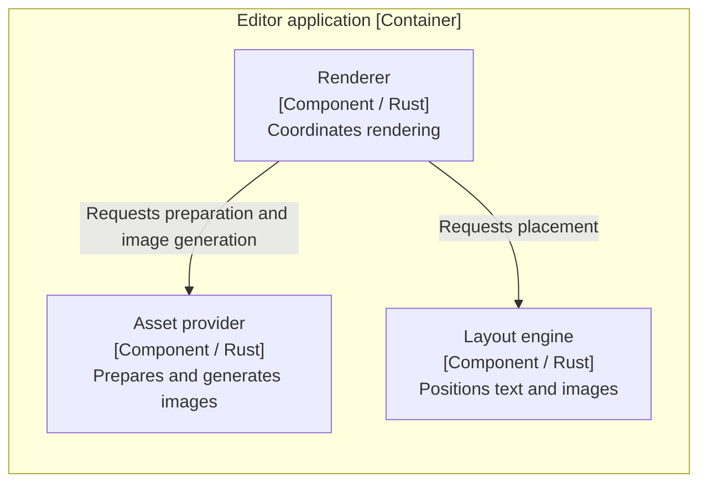
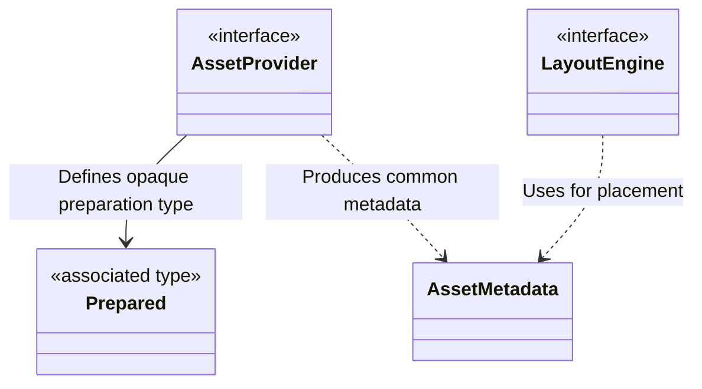
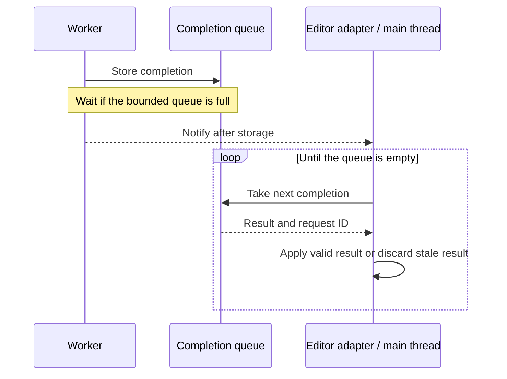

# Design Doc writing guide

Use this guide while exploring architecture through a Draft and when finalizing
or substantively revising a Design Doc. It defines
what readers should understand and how to choose a useful representation. Keep
the document proportional to the actual decisions; diagrams, section counts,
paragraph lengths, and example technologies are not universal requirements.

Use [Design docs — A design doc](https://www.industrialempathy.com/posts/design-doc-a-design-doc/)
as the presentation reference. Its useful pattern is an early central idea,
progressive detail, and passages that build on an understanding already
established for the reader. Lists contribute to that explanation rather than
determine its form. Apply the rules below on each new document or substantive
revision, then check both
readability and preservation. These are local writing rules derived from the
approved discussion, not a requirement to copy the article's text or workflow.

## Develop the explanation with the user

Start from what the user has already explained about the problem, background,
and priorities. Recover it from the requirements and settled discussion before
asking for more input. AI may prepare that known foundation. Rough notes,
diagrams or spoken explanations are sufficient; polished human prose is not a
prerequisite. Edit within the agreed scope while preserving the user's meaning
and reasons, honoring requests to keep wording verbatim. Clarify a specific
unrecoverable gap rather than asking the user to repeat the whole story.

For a new document, adapt the
[guided Japanese template](../assets/design-doc-template-ja.md), including its
what-to-write and how-to-start guidance. Translate it when another language is
requested. Normally begin with known Context, Goals, Non-goals, an outline and
clearly separated writing prompts. Do not populate a new Draft with provisional
designs or unorganized opinions; work through them in the design loop and
consolidate organized findings. Leave unexamined decisions open. Reuse an
existing suitable Draft or agreed framing. The template is an output scaffold, not another instruction
manual, mandatory concern list or fixed project architecture.

Work by heading, subheading or connected group of sections. The engineer may
use bullets, diagrams, pseudocode or unfinished prose while investigating,
comparing and trying approaches; AI may prepare foundations and organize that
material before adding it to the Draft. Preview the proposed wording and
structure as affected sections or a useful diff before writing, following the skill's
[preview and write-confirmation rule](../SKILL.md#explore-validate-and-write-together).
Do not make rereading a complete generated document the normal editing
interaction. Connect changes back to the whole; split, merge or reorder headings
when helpful. Write confirmation adds no chapter-level design approval, fixed
writing round or requirement that the engineer draft before AI can help. Honor
an explicit request for the complete document, including final approval.

After Model Aligning, use the evolving Draft to explore architecture; writing
does not wait for all design choices to settle. Plan the explanation around
what the reader needs to understand next, rather than the chronology or
prominence of topics in the conversation. Expand the refined framing with
organized exploration results, settled choices, considered alternatives and
open questions. Develop
realization choices with the user in the same loop; return new product choices
or input-meaning gaps through the coordinator to the appropriate earlier phase.
Do not silently settle a choice while editing or invent a reason to complete a
template field. Questions exposed by writing or editing return to exploration.
Use the
[exploration guide](exploration-guide.md) for frequent, proportionate validation
and for updating the Draft from observations.

Use the developing explanation as a model to think with. Connect requirements
to responsibilities and interactions, show how they compose into guarantees,
and use relevant changed or failure conditions to expose gaps. Human and AI can
revise the framing and the model while doing this; an explanation assembled from
approved choices alone may still lack those connections. Preserve the material
reasoning and evidence so the model remains usable beyond the conversation.

Template guidance can remain visible while working on a section. Put temporary
writing aids, such as section prompts or reminders to write something after a
discussion, in labeled Markdown blockquotes (for example, `> **執筆メモ**: ...`)
or another clearly separated annotation. Keep this authoring guidance visually
distinct from design prose, including tentative proposals, open design questions
and evidence. Before final presentation, remove superseded prompts and empty
scaffolding, consolidating useful notes into the explanation or surviving
evidence references. Preserve material reasons, constraints, evidence limits and
accepted deferrals rather than treating cleanup as permission to discard
unfinished or inconvenient work.

## Chapter purposes

| Chapter | What the reader should understand |
| --- | --- |
| Context and scope | The problem, relevant background, scope, and requirements/specifications/established constraints that inform the design. Link to their originals and summarize the inputs needed to judge this design. |
| Goals and Non-goals | The outcomes this design serves and plausible adjacent outcomes explicitly outside its scope. Keep these lists short. |
| Overview | The central approach first, followed by its reason, major boundaries, and a representative path. Readers can place later decisions without first reconstructing implementation details. |
| Detailed design | An opening that orients the reader to the design question and approach, followed by connected explanations of mechanisms, models, contracts, invariants, reasons, conditions, and consequences. Use a decision map when it helps navigation. |
| Cross-cutting concerns | How this design addresses applicable concerns such as security, performance, operation, migration, and verification. Explain design-specific effects and responses rather than generic checklists. |
| Alternatives considered | The viable alternatives, their benefits, and why the selected approach better serves the goals, including burdens accepted with that choice. |

### Build Context toward Overview

Connect the relevant background, problem, and scope so the reader understands
why this design is being explained. Use the user's actual intent and known
facts; do not fabricate shortcomings of existing tools or a generic motivating
story. A stated preference can be sufficient background without an invented
claim about the current workflow.

Keep detailed mechanisms and failure/state contracts with the Overview or
Detailed design explanation they support. A decisive technical constraint may
still belong in Context, stated briefly with its authority. Keep requirements
sources and scope references readable without interrupting the explanation
with a mixture of mechanism, provenance, and administrative notes.

Overview then explains the chosen structure and representative path, preparing
readers for the detailed decisions. Introduce concepts before relying on them,
and explain the causal link when moving to a new concern rather than expecting
the reader to reconstruct it from the discussion.

### Let readers choose how deeply to read

Make headings and paragraph openings useful to a reader skimming for purpose,
the central approach, and major decisions. A heading can state a decision or
name a topic; an informative opening sentence can orient the reader in either
case. Do not require answer-shaped headings everywhere.

Develop the overall mechanism before zooming into library names, callbacks,
type representations, or multiple structural views. Keep details that establish
a significant guarantee, but explain their role before their mechanics. A
diagram supplements this explanation; it should not be the only way to discover
how the system works. Link prerequisites or supporting detail rather than
expand every chapter into a complete specification.

### Orient the Detailed design chapter

Start with a brief explanation of what readers will understand and how it
relates to the approach already introduced in Overview. Choose an opening that
helps develop that understanding: a concise decision roadmap can aid
navigation, while relevant constraints, criteria, or a real trade-off can
explain why the mechanisms that follow are needed. Do not invent a conflict to
fit a rhetorical pattern or withhold the central approach to build suspense.

Make a list's role clear. A roadmap points to later decisions; a set of criteria
needs interpretation before it can justify a choice. The reference article's
initial list establishes desired properties and their tension, rather than a
universal roadmap template. When using a roadmap, give its items meaningful
decisions rather than labels such as "API" and "Data", and match the sections
that follow. In a Draft, identify unresolved approaches as proposals or
questions. A small chapter may need only a framing paragraph.

Develop reasons, mechanisms, and consequences from that opening. Neither a
roadmap nor another opening pattern is required in every subsection. Add no
fixed item count or approval exchange for the choice of presentation.

## Organize around design questions

Give each detailed section one coherent design question, such as how layout
stays independent of image generation or how stale results are kept out of the
display. Introduce the mechanism, explain the reason, and connect its material
conditions and consequences. These are meanings to communicate, not a required
set of repeated Decision / Rationale / Consequence subheadings.

Explain the basic structure or path before qualifications and exceptional
cases. Keep a mechanism's principal rationale beside its explanation; the
Alternatives section can deepen the comparison. Give independent concerns
their own sections or explicit cross-references instead of appending every
caveat to the nearest paragraph.

Distinguish requirements, established constraints, observed facts, selected
design, provisional proposals, and unverified assumptions. A polished
explanation cannot supply a missing decision. Open architecture questions stay
visible in the working Draft and the exploration loop; material input gaps
return through the coordinator. Final approval requires settled choices except
explicitly accepted deferrals and their impacts.

Review narrative continuity and source coverage as distinct aspects of the
same draft review. Read the explanation as someone who did not attend the
discussion, then check that material decisions, guarantees, constraints, and
reasons survive condensation or relocation. Move detail to a relevant section
or retain a precise source reference instead of losing it for brevity or
packing it into the introduction for coverage.

## Write connected prose

Give a paragraph a recognizable point and an explanatory role, such as
grounding a concept, explaining a reason, or interpreting conditions. Let its
sentences develop that point. Start another paragraph when the point changes;
short sentences alone do not create continuity.

Carry forward the understanding established in the preceding passage when
introducing a new mechanism or condition. Make the relevant causal,
contrastive, or other relationship recoverable. When changing concerns, orient
the reader to why the new concern matters to this design. Adding "therefore"
or "however" cannot supply a missing premise or make unrelated facts causal.

Retain useful repetition when an established concept anchors a new implication.
Stable terms and a brief reminder can help readers keep their place; removing
every recurrence as redundancy can break that connection. This does not
require repeating a subject or connective in every sentence.

Prefer compact paragraphs that readers can take in at a glance. Even within
one topic, separate paragraphs when the explanatory role changes, such as from
the basic mechanism to an exception or from a concrete case to a different
guarantee.

Expose independently checkable operations, conditions, or
responsibilities in a list when they accumulate in prose. Keep the connecting
reasoning nearby so the reader can understand why the items belong together.
Use these relationships and the size of the reading block to choose breaks;
do not impose a sentence, character, or rendered-line limit.

Make the actor and action recoverable. Explain what a component does and why
before compressing it into abstractions such as "validity", "ownership", or
"separation". Those terms remain useful once grounded. Avoid stacking nominal
phrases or joining different logical levels with an unexplained "and".
Introduce project-specific names by role, retain exact identifiers where useful,
and keep terminology stable. Japanese can omit a repeated subject when the
actor remains clear; it need not repeat a subject mechanically in every sentence.

Describe the selected behavior before its qualifications where possible.
Preserve material exclusions, failure cases, and negative requirements beside
the mechanism they constrain. Clarify them rather than remove them for flow.
Use natural prose in the requested language; English is not a readability fix
for Japanese, and foreign identifiers do not justify unrelated language fragments.

## Choose the representation for the relationship

- Use prose for causality, rationale, trade-offs, and the connection between
  parts of the design. Keep each paragraph focused on one connected point.
- Use bullet lists for independent conditions or items and numbered lists for
  meaningful order.
- Use tables for mappings or comparisons with common axes. Explain a complex
  relationship in prose instead of compressing a paragraph of unrelated
  obligations into each cell.
- Use diagrams when structure, relationships, state, or interaction would
  otherwise have to be reconstructed from scattered statements. Explain why
  the depicted structure or behavior was chosen in nearby prose.

Introduce what a list enumerates and what readers should do with it, such as
locate a decision, check conditions, or compare criteria. Keep its items parallel
in meaning and abstraction level. Where their relationship or implication
matters, interpret it in nearby prose rather than leave readers to infer it.
If a sentence contains many separate rules, expose that structure as a list
instead of hiding it behind commas or slashes. Continue in prose when the relationship,
trade-off, or consequence needs interpretation. Do not replace causal explanation
with bullet fragments, prescribe a prose/list ratio, or repeat an introduction,
list, and conclusion mechanically when they add no meaning.

Before final presentation, skim headings, paragraph openings, and list items
for the design's outline and main decisions. Check whether readers can tell
what a paragraph covers before reading it closely and find a particular
operation or condition without rereading a dense block.

Then read a substantive section continuously, checking what the reader already
understands at a transition, what the current passage adds, and what the next
explanation relies on. Ground that check in the actual passages. If readers
must invent a premise, resolve an unexplained topic change, or reconstruct the
connection between a list and its conclusion, revise the explanation or order.
A claim that the prose is coherent or the presence of connectives is not enough.

Use this as an editorial diagnostic at meaningful transitions, not mandatory
per-paragraph annotations, output labels, a repeated three-part template, or
an extra user comprehension test. It adds no document or approval gate.

Separately compare with the settled source for lost guarantees, rationale,
conditions, and evidence limits. A smoother or shorter draft has not passed
that second check merely because it reads well. This is editorial review, not
an extra user gate.

### Architecture and behavioral views

Use C4 to select the abstraction level and meaning of structural views, and
draw those views with Mermaid `flowchart` for readability. Do not use Mermaid's
dedicated `C4Context`, `C4Container`, `C4Component`, or other `C4*` syntax.
This is the presentation convention for this workflow, not a requirement of
the C4 model itself.

Keep process/exploration flows easy to follow. When Mermaid's automatic routing
makes their branches or return edges hard to read, use a simple ASCII flow with
explicit return conditions. An equivalent ASCII structural view may also be
used when it communicates the selected C4 level and boundaries more clearly;
retain the relationship meanings rather than forcing a renderer or layout.

Select only levels that help explain this design: context for surrounding
systems, containers for applications/data stores and runtime boundaries, and
components for responsibility boundaries inside a container. Preserve those
distinctions in the flowchart: name its C4 level and scope, identify element
roles and responsibilities in labels, use `subgraph` for relevant boundaries,
and label the direction and meaning of relationships. Include technology where
it explains a container or component. A crate, module, or shared library is
not automatically a C4 container. Do not mix code dependencies and runtime
data paths without making the distinction explicit.

Overview establishes the system architecture. It may need component detail for
a library or plugin, so chapters do not map one-to-one onto C4 levels. Detailed
design zooms into the boundaries whose mechanisms and rationale need scrutiny.

Use focused class/ER diagrams or similar views for important type/data
relationships. Use sequence diagrams or equivalent behavioral views when
ordering, asynchronous notifications, concurrency, or handoffs matter to a
guarantee. Overview may show the representative path; Detailed design explains
significant interactions, failure, and recovery. Select the meaningful paths
rather than drawing every operation or exception. Static structure alone does
not establish runtime ordering or progress.

### Module structure and API ownership

Show the major module/package hierarchy at the design scope with a tree or
equivalent structural view, and map the relevant boundaries to source files
and directories. Make parent/child relationships explicit. A directory listing
alone does not establish which file defines a parent module or owns its API.

Identify each major boundary's responsibilities and API owner, its consumers,
visibility, and supported access paths, including re-exports. An API may be
public to another module without being public outside its crate or package;
name that audience. Distinguish the owner of the supported API surface from
the location of internal definitions. Locate important traits and interfaces
in this structure rather than presenting their declarations in isolation.

Explain source dependency direction and the reason for the chosen boundaries
near the structural view. Keep it distinct from runtime messages, notifications,
and data flow. State which relationships or source paths are design constraints
and which names or local helper details remain explanatory or flexible.

### Conceptual models and public APIs

Show important concepts, their relationships and states, who owns them, and
where invariants are enforced. Include both persistent and domain/type models
when relevant. For major communication and module/library APIs, make the
abstraction and principal operations visible: input/output meaning, ownership,
side effects, errors, synchronous/asynchronous behavior, and caller obligations
where significant. Explain the role of a trait, interface, callback, or
associated type rather than listing its name alone.

Describe each major API in the form selected by the design. In Rust, show the
significant part of the trait declaration when a trait defines the boundary.
For APIs provided by concrete types or modules, show their public operations
or function signatures. Do not introduce a trait solely to express a contract
in the document. Map each API to its owning module, visibility, and supported
access path in the module structure.

Use a small diagram, table, or short conceptual signature to expose that
structure. Label explanatory names and sketches as such. A conceptual
signature does not by itself settle borrowing, ownership transfer, or reuse;
state any material ownership and lifetime guarantees explicitly. Exact types,
signatures, or representations belong here when a material design decision or
compatibility obligation depends on them. Reference exhaustive maintained
definitions rather than reproducing every field or method. Implementation
choices that preserve the settled design remain with implementation.

### Explain a module API from the caller's perspective

Keep the API's role, declarations and observable contract in one coherent
explanation rather than making readers reconstruct them from scattered prose.
A useful progression is:

1. Establish the module's responsibility, API owner, consumers and supported
   access path. Make clear which decisions remain with the caller.
2. Show representative values and operations with short declarations in the
   selected language when helpful. Explain what important types identify,
   contain or own; omit exhaustive fields, helpers and implementation bodies.
3. Explain operation outcomes beside the declarations: what success, absence or
   failure means, the relevant ownership/lifetime effects, and obligations on
   each side. Distinguish failure stages only where they matter to callers.
4. Show a representative use sequence or small usage example that explains how
   operations compose. Include ordering, retry or cleanup responsibilities when
   material; skip trivial examples that merely repeat a signature.
5. Connect the API shape to the design's goals and accepted burdens. Explain why
   the boundary and operations have this form, with alternatives linked where
   their comparison is already maintained.

This is an explanatory progression, not five mandatory headings per API or
method. Share module-wide rules and explain only material operation-specific
differences. Preserve the actual chosen trait, concrete type or module-function
form; do not copy the example's types, error layering or return shapes into
unrelated designs.

When state ownership, initialization/termination, failure recovery or returned
ownership is unsettled, identify the open choice in the Draft. Do not make an
invented error type or a plausible signature stand in for deciding its semantics.
The Japanese example's module API section illustrates this presentation with
explicitly open lifecycle and error questions, not an approved API to implement.

### Alternatives

Default to a heading and short connected prose for each meaningful alternative.
Explain the approach and its benefits, the selection/rejection rationale, and
the material burden accepted with the selected approach. Use a comparison
table when shared evaluation axes make differences easier to understand. Keep
each explanation in one place instead of repeating it in both table and prose.
Do not invent alternatives or comparisons just to populate this section.

## Short examples

For the complete progression in Japanese, read
[example-design-doc-ja.md](example-design-doc-ja.md). It demonstrates a focused
document's framing, overview, purposeful detailed-design opening, prose/list
handoffs, conceptual model/API, and interaction view. Keep its architecture scoped to the
example; use these excerpts for additional views rather than copying every view
into every document.

These excerpts illustrate presentation of already settled decisions in a
document-preview design. They are not a complete Design Doc or a recommendation
to adopt its libraries, architecture, or policies in another project.

### Establish the problem before explaining the mechanism

Assume the settled inputs say that the user wants to review Markdown design
documents in the editor, read text/tables/diagrams/images together, switch
between editing and preview in the same window, and preserve source changes
and Undo. The selected design separates rendering workers from the editor
adapter that owns window state and display updates. No claim about shortcomings
of the user's existing tools has been established.

#### Context excerpt

The plugin supports reviewing Markdown design documents inside the editor,
including their text, tables, diagrams, and images. Readers can edit the source
and return to the preview in the same window while retaining unsaved changes
and Undo.

This document describes the plugin's structure and the division of
responsibilities between rendering and display. The requirements source retains
the full supported behavior and environment constraints.

#### Overview excerpt

The editor adapter owns window state and display resources. It captures the
source and display conditions, then submits them to rendering workers. The
workers compute output independently of editor state, and the adapter checks
completed results before applying them to the current window.

This separation keeps rendering work off the editor's interaction path and
concentrates editor operations in the adapter. The adapter therefore also
owns result-validity checks and display-resource cleanup. The detailed sections
explain the queue handoff, stale-result handling, and resource lifetimes.

The excerpts separate the user's purpose and scope from the chosen mechanism.
They introduce no new motivating facts and leave the technical guarantees in
the sections that explain them, with the full source coverage still required.

### Explain component responsibilities with a flowchart

Component view: rendering components inside the editor application container.
The boundary denotes the application, and each node names a component, its
technology, and its responsibility. Arrows show which component calls another;
they do not establish execution order.



The renderer coordinates asset preparation and layout. Layout relies on common
asset metadata, while the asset provider owns image-generation details. This
separation lets layout remain independent of the image implementation; the
renderer takes responsibility for connecting the two stages.

### Locate API owners in the module structure

The component view describes responsibilities. For this example, the selected
source structure places those boundaries as follows; only the relevant files
are shown.

```text
src/
├── renderer.rs         # Owns rendering orchestration
├── assets.rs           # Owns the asset API and common metadata
├── assets/
│   └── provider.rs     # Internal image-provider implementation
└── layout.rs           # Owns the layout API
```

`assets.rs` defines the parent module `crate::assets`;
`assets/provider.rs` defines its child `crate::assets::provider`. The parent
owns the supported API surface, including child declarations and any
re-exports. The child implements provider-specific behavior behind it.

The renderer uses the asset and layout APIs through `crate::assets` and
`crate::layout`. Layout uses `AssetMetadata` through `crate::assets`, so it
can consume common dimensions without importing the provider implementation.
These are crate-internal boundaries; the provider child is internal to
`assets`. These source dependencies do not establish runtime order.

### Explain a module boundary and its model

Image preparation returns common metadata and a provider-specific prepared
value. Layout needs dimensions but does not need the image library's internal
state. Keeping that state behind the provider lets layout remain independent
of the image-generation implementation.

In this Rust example, `AssetProvider` and `LayoutEngine` are trait boundaries
owned by `assets` and `layout`, respectively. The following conceptual trait
sketches show their principal operations. Names and declaration syntax are
illustrative, not binding Rust declarations.

```text
trait AssetProvider
    associated type Prepared
    prepare(AssetInput) -> Result<(AssetMetadata, Prepared), AssetError>
    materialize(Prepared, ImageSize) -> Result<PNG, AssetError>

trait LayoutEngine
    layout(Document, DisplayConditions, AssetMetadata[])
        -> Result<LayoutOutput, LayoutError>
```

The provider owns the meaning of `Prepared`; layout sees only common metadata.
Its prepared values must remain valid through image generation. The signature
sketch leaves their borrowing/reuse representation open while retaining that
lifetime obligation. The split adds a preparation stage and coordination
between layout and image generation.

Conceptual model: the provider owns the opaque prepared type, while layout
depends on shared metadata. The arrows show ownership of the abstraction and
type use, not the timing of method calls.



### Explain order and progress

Workers put results into the completion queue before notifying the editor.
The editor then drains the queue, including results no longer needed for
display. Notifications may be coalesced, so one notification is not one result.

Sequence diagram: completion handoff between a worker and the editor adapter.
The arrows describe runtime messages, not source-code dependencies.



If the completion queue is full, a worker waits before taking another request.
Continued draining is therefore required for progress even when the visible
document has changed. Queue capacity bounds item count, not total image bytes.

### Explain an alternative

#### Render in an external backend

A separate backend can isolate native failures from the editor. It also
requires process startup, communication, and shutdown management.

This design selects an in-process shared library to keep the execution
structure small. It accepts that native failures are not isolated from the
editor process.

## Sources

- [Design Docs at Google](https://www.industrialempathy.com/posts/design-docs-at-google/)
- [Design docs — A design doc](https://www.industrialempathy.com/posts/design-doc-a-design-doc/)
- [C4 diagrams](https://c4model.com/diagrams)
- [Mermaid flowchart syntax](https://mermaid.js.org/syntax/flowchart.html)
