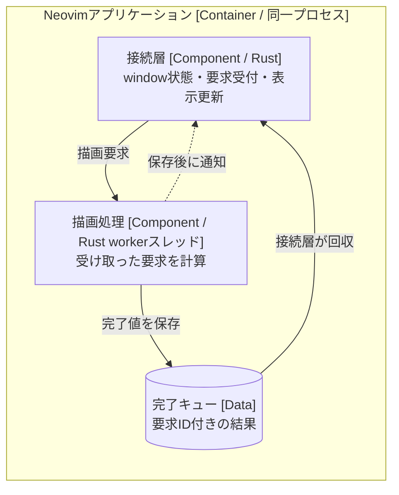
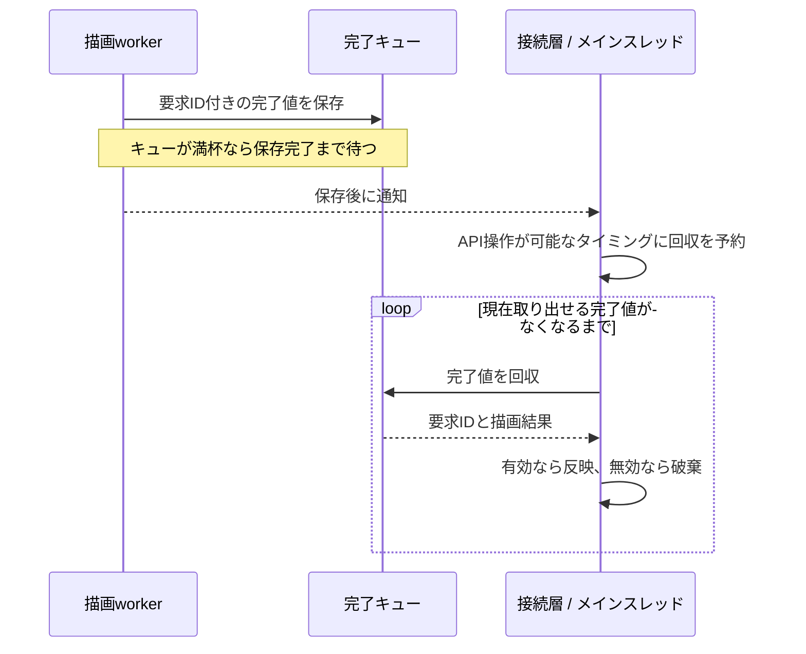

# [Design Doc] 非同期描画でプレビューを更新する

> 日本語での文章構成を示す、主題を絞った記述例です。以下の要求と技術選択は説明用の仮定であり、実プロジェクトの設計権限や検証結果を表すものではありません。

## Context and scope

Neovimで文書を編集しながら、整形したプレビューも確認したい。利用者は同じwindowの中で編集と閲覧を切り替える。原文と未保存の変更、Undoは保持し、閲覧を終えたら編集へ戻れるようにする。

図を含む文書では、プレビューを作る計算に時間がかかる場合がある。その間も利用者は操作を続けられなければならない。また、計算を待つ間に別の描画を要求したり、編集表示へ戻ったりすることもある。完成した結果を無条件に表示すると、古い内容へ戻したり、利用者が閉じたプレビューを再び開いたりしてしまう。

本書では、Rustの描画処理とNeovimの表示をどう接続するかを設計する。文書を解析・配置するアルゴリズムは扱わず、要求の受け渡しと結果を表示する条件に焦点を当てる。

### Goals

- 描画計算でNeovimのメインスレッドを占有しない。
- 描画が終わった時点で有効な要求の結果だけを表示する。
- 同じ原文を開いた複数のwindowで、表示モードと要求を独立させる。
- 不要になった結果も回収し、後続の描画を進められるようにする。

### Non-goals

- Markdownや図を解析・配置するアルゴリズムの設計。
- 通常操作向けの、実行中の描画を取り消すAPI。
- 端末画像の転送・削除方式や、具体的なクレートの分割。

## Overview

中心となる方針は、Neovimの表示を管理する接続層から、workerスレッドへ描画計算を任せることである。接続層は対象の原文と表示条件を描画要求に入れて渡す。workerはその値を使って計算し、完成した結果を完了キューへ戻す。NeovimのAPIは接続層がメインスレッド上で操作する。

この構成では、計算の完了と表示の更新を別の判断として扱う。workerには計算を完了する責任を持たせ、接続層には現在のwindowへ反映してよいかを決める責任を持たせる。要求を出した後にwindowの状態が変わっても、接続層がその変化を踏まえて表示を判断できる。

次は、Neovimアプリケーション内部のC4 component viewである。実線は要求・結果の受け渡し、破線は結果が用意されたことの通知を表す。ソースコードの依存方向を示す図ではない。



以下では、計算に渡すデータ、結果を表示する条件、完了通知と回収の順序を説明する。スレッドを分けるだけでは、表示の正しさや後続要求の進行までは決まらないためである。

## Detailed design

接続層と描画処理は、所有した要求と完了値を受け渡す。この境界を通じて、次の三つを実現する。

- 描画には原文の写しを渡し、計算中に入力の内容が変わらないようにする。
- windowごとに表示要求を管理し、有効な結果だけを反映する。
- 結果をキューへ入れてから通知し、不要な結果も回収して処理を進める。

### 描画には原文の写しを渡す

描画要求は、その計算に使う原文の写しと表示条件を所有する。ここでいう原文の写しをsnapshotと呼ぶ。workerは受け取ったsnapshotを使い、計算の途中でNeovimのbufferを読み直さない。これにより、一件の結果がどの内容から生成されたかを特定できる。

境界を説明する主要な値は次のとおりである。表は概念モデルを示し、完全な型宣言や全フィールドを定めるものではない。

| 概念 | 保持する情報 | 所有する側 |
| --- | --- | --- |
| 描画要求 | snapshotと表示条件 | 受付後は描画処理 |
| 完了値 | 要求IDと描画の成功・失敗 | 保存中は完了キュー、回収後は接続層 |
| window状態 | 対象文書、表示要求の有効性、最新の受理済み要求ID | 接続層 |

接続層は要求を送ると、描画の完了を待たずに操作へ戻る。以下は、このやり取りを示す概念的なAPIである。名前と宣言構文は説明用であり、正式な実装を指定しない。

```text
submit(snapshot, 表示条件)
    -> 受付成功(RequestId) | 受付失敗

try_next_completed()
    -> 完了値あり | 現在は完了値なし | 回収失敗
```

要求の受付成功は、描画の成功を意味しない。接続層は、受付が成功したときだけ、そのIDをwindowの最新受理IDとして記録する。受付に失敗した要求でこの値を更新すると、既に計算中の有効な結果まで古いものとして捨ててしまうためである。

### windowごとに表示要求を管理する

同じ原文を二つのwindowで開いていても、一方を編集表示のまま残し、もう一方だけをプレビューへ切り替えられるようにする。原文bufferはそのまま保持し、プレビューには各window専用の読み取り専用bufferを使う。

描画が終わるまでに、windowが閉じられたり、別の文書へ移動したりすることがある。このため、接続層は結果を反映する直前に、次の条件を全て確認する。

- 対象のwindowがまだ存在する。
- windowが対象としている文書と、結果の文書が一致する。
- プレビューの表示要求が引き続き有効である。
- 結果の要求IDが、そのwindowの最新受理IDと一致する。

例えば、描画中に利用者が編集表示へ戻った場合、windowと文書が同じでも、プレビューの表示要求は既に失効している。完了した結果は回収して破棄し、画面をプレビューへ戻さない。描画の失敗を通知するときにも同じ条件を使い、不要になった要求のエラーを表示しない。

初回の計算中は原文が表示されている。そのため、現在プレビュー用bufferを表示していることは条件に加えない。また、新しい要求の受付から結果の確認・表示更新までは、接続層がメインスレッドで順序づける。確認と反映の間に別の要求が割り込める構成へ変えるなら、この保証も見直す必要がある。

### 結果をキューへ入れてから通知する

workerは完了値をキューへ格納した後、接続層へ通知する。接続層は通知を受け、NeovimのAPIを操作できるタイミングで完了キューを調べる。通知より先に結果を保存することで、通知を受けたのに結果がまだ見つからない、という取りこぼしを避ける。

次のシーケンス図は、計算終了から結果回収までの順序を示す。



複数の通知は一つにまとまる場合があるため、一回の通知を一件の結果と対応づけない。接続層はキューを空になるまで調べ、表示に使わない結果も回収する。

完了キューには容量を設け、満杯ならworkerを待たせる。この構成では、古い結果の回収を止めるとworkerも次の計算へ進めなくなる。表示しないことと回収しないことを区別し、windowを閉じた後も結果を捨てる経路を残す。

## Cross-cutting concerns

初回描画が失敗した場合は原文を残し、更新に失敗した場合は既存のプレビューを残す。成功した結果と同様に、失敗の通知にも表示要求の有効性を確認する。

本文や画像をNeovimへ反映する処理はメインスレッドに残る。描画計算を移したことだけで、操作遅延の目標を達成したとは判断しない。実装後に反映時間と操作遅延を測り、必要なら適用処理の分割を検討する。キューの容量も項目数を制限するものであり、画像を含む総メモリ量の上限ではない。

検証では、古い計算が後から終わる順序、計算中の編集表示への復帰、windowの破棄、受付失敗、通知の集約、完了キューの満杯を扱う。特に、古い結果を捨てながら最新の要求が表示まで進むことを確認する。これらは検証方針であり、本例で実行済みとする結果ではない。

## Alternatives considered

### メインスレッドで同期的に描画する

要求と結果をスレッド間で受け渡す必要がなく、実行構成は小さくなる。一方、描画計算が終わるまでNeovimの操作を待たせる。

本例では、計算中も操作できることを優先してworkerへ移す。代わりに、要求と完了値の所有権、結果の有効性、通知と回収の順序を管理する負担を引き受ける。

### 新しい要求のたびに古い計算を取り消す

表示されない結果の計算を止められれば、CPUやメモリの消費を減らせる。ただし、計算が取消しを確認するまでに完了する場合もあるため、取消しだけでは表示の有効性確認を省けない。

本例では古い計算も完了させ、表示時に不要な結果を捨てる方式を選ぶ。表示しない計算もworkerを使い続ける負担は残る。これが最新要求の待ち時間に影響すると実測された時点で、協調的な取消しを再検討する。
