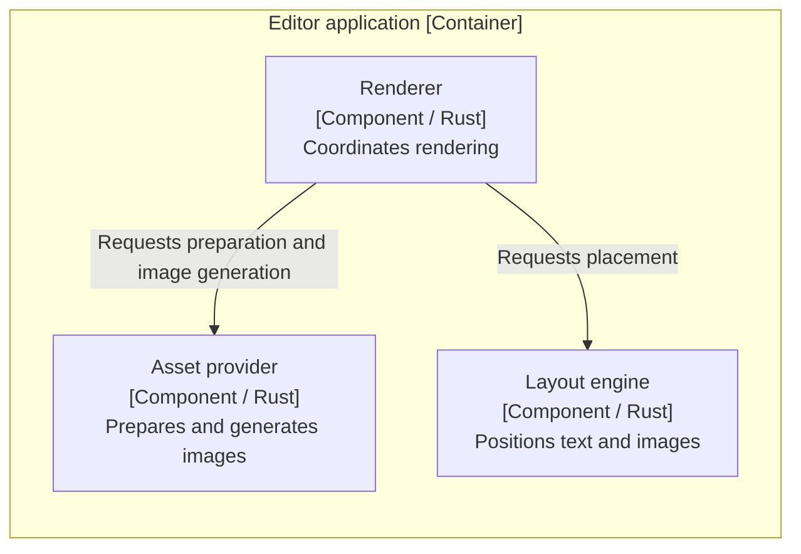
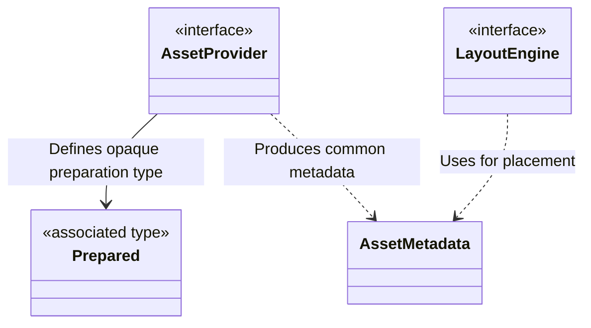
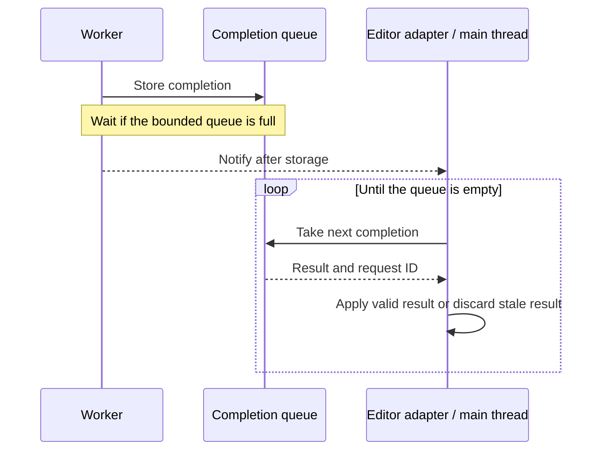

# Design Doc writing guide

Use this guide when drafting or substantively revising a Design Doc. It defines
what readers should understand and how to choose a useful representation. Keep
the document proportional to the actual decisions; diagrams, section counts,
paragraph lengths, and example technologies are not universal requirements.

## Chapter purposes

| Chapter | What the reader should understand |
| --- | --- |
| Context and scope | The problem, relevant background, scope, and requirements/specifications/established constraints that inform the design. Link to their originals and summarize the inputs needed to judge this design. |
| Goals and Non-goals | The outcomes this design serves and plausible adjacent outcomes explicitly outside its scope. Keep these lists short. |
| Overview | The chosen overall approach, major responsibilities and boundaries, relationships to surrounding systems, and representative processing flow. Readers can locate later decisions within the architecture. |
| Detailed design | The significant mechanisms, models, public contracts, invariants, and why they were chosen, including their conditions and consequences. |
| Cross-cutting concerns | How this design addresses applicable concerns such as security, performance, operation, migration, and verification. Explain design-specific effects and responses rather than generic checklists. |
| Alternatives considered | The viable alternatives, their benefits, and why the selected approach better serves the goals, including burdens accepted with that choice. |

## Organize around design questions

Give each detailed section one coherent design question, such as how layout
stays independent of image generation or how stale results are kept out of the
display. Introduce the mechanism, explain the reason, and connect its material
conditions and consequences. These are meanings to communicate, not a required
set of repeated Decision / Rationale / Consequence subheadings.

Explain the basic structure or path before qualifications and exceptional
cases. Keep a mechanism's principal rationale beside its explanation; the
Alternatives section can deepen the comparison. Give independent concerns
their own sections or explicit cross-references instead of appending every
caveat to the nearest paragraph.

Distinguish requirements, established constraints, observed facts, selected
design, and unverified assumptions. A polished explanation cannot supply a
missing decision. Return material gaps through the owning workflow.

## Choose the representation for the relationship

- Use prose for causality, rationale, trade-offs, and the connection between
  parts of the design. Keep each paragraph focused on one connected point.
- Use bullet lists for independent conditions or items and numbered lists for
  meaningful order.
- Use tables for mappings or comparisons with common axes. Explain a complex
  relationship in prose instead of compressing a paragraph of unrelated
  obligations into each cell.
- Use diagrams when structure, relationships, state, or interaction would
  otherwise have to be reconstructed from scattered statements. Explain why
  the depicted structure or behavior was chosen in nearby prose.

### Architecture and behavioral views

Use C4 to select the abstraction level and meaning of structural views, and
draw those views with Mermaid `flowchart` for readability. Do not use Mermaid's
dedicated `C4Context`, `C4Container`, `C4Component`, or other `C4*` syntax.
This is the presentation convention for this workflow, not a requirement of
the C4 model itself.

Select only levels that help explain this design: context for surrounding
systems, containers for applications/data stores and runtime boundaries, and
components for responsibility boundaries inside a container. Preserve those
distinctions in the flowchart: name its C4 level and scope, identify element
roles and responsibilities in labels, use `subgraph` for relevant boundaries,
and label the direction and meaning of relationships. Include technology where
it explains a container or component. A crate, module, or shared library is
not automatically a C4 container. Do not mix code dependencies and runtime
data paths without making the distinction explicit.

Overview establishes the system architecture. It may need component detail for
a library or plugin, so chapters do not map one-to-one onto C4 levels. Detailed
design zooms into the boundaries whose mechanisms and rationale need scrutiny.

Use focused class/ER diagrams or similar views for important type/data
relationships. Use sequence diagrams or equivalent behavioral views when
ordering, asynchronous notifications, concurrency, or handoffs matter to a
guarantee. Overview may show the representative path; Detailed design explains
significant interactions, failure, and recovery. Select the meaningful paths
rather than drawing every operation or exception. Static structure alone does
not establish runtime ordering or progress.

### Conceptual models and public APIs

Show important concepts, their relationships and states, who owns them, and
where invariants are enforced. Include both persistent and domain/type models
when relevant. For major communication and module/library APIs, make the
abstraction and principal operations visible: input/output meaning, ownership,
side effects, errors, synchronous/asynchronous behavior, and caller obligations
where significant. Explain the role of a trait, interface, callback, or
associated type rather than listing its name alone.

Use a small diagram, table, or short conceptual signature to expose that
structure. Label explanatory names and sketches as such. A conceptual
signature does not by itself settle borrowing, ownership transfer, or reuse;
state any material ownership and lifetime guarantees explicitly. Exact types,
signatures, or representations belong here when a material design decision or
compatibility obligation depends on them. Reference exhaustive maintained
definitions rather than reproducing every field or method. Implementation
choices that preserve the settled design remain with implementation.

### Alternatives

Default to a heading and short connected prose for each meaningful alternative.
Explain the approach and its benefits, the selection/rejection rationale, and
the material burden accepted with the selected approach. Use a comparison
table when shared evaluation axes make differences easier to understand. Keep
each explanation in one place instead of repeating it in both table and prose.
Do not invent alternatives or comparisons just to populate this section.

## Short examples

These excerpts illustrate presentation of already settled decisions in a
document-preview design. They are not a complete Design Doc or a recommendation
to adopt its libraries, architecture, or policies in another project.

### Explain component responsibilities with a flowchart

Component view: rendering components inside the editor application container.
The boundary denotes the application, and each node names a component, its
technology, and its responsibility. Arrows show which component calls another;
they do not establish execution order.



The renderer coordinates asset preparation and layout. Layout relies on common
asset metadata, while the asset provider owns image-generation details. This
separation lets layout remain independent of the image implementation; the
renderer takes responsibility for connecting the two stages.

### Explain a module boundary and its model

Image preparation returns common metadata and a provider-specific prepared
value. Layout needs dimensions but does not need the image library's internal
state. Keeping that state behind the provider lets layout remain independent
of the image-generation implementation.

The following conceptual signatures expose the significant boundary. Names
and declaration syntax are illustrative.

```text
AssetProvider
    associated type Prepared
    prepare(AssetInput) -> Result<(AssetMetadata, Prepared), AssetError>
    materialize(Prepared, ImageSize) -> Result<PNG, AssetError>

LayoutEngine
    layout(Document, DisplayConditions, AssetMetadata[])
        -> Result<LayoutOutput, LayoutError>
```

The provider owns the meaning of `Prepared`; layout sees only common metadata.
Its prepared values must remain valid through image generation. The signature
sketch leaves their borrowing/reuse representation open while retaining that
lifetime obligation. The split adds a preparation stage and coordination
between layout and image generation.

Conceptual model: the provider owns the opaque prepared type, while layout
depends on shared metadata. The arrows show ownership of the abstraction and
type use, not the timing of method calls.



### Explain order and progress

Workers put results into the completion queue before notifying the editor.
The editor then drains the queue, including results no longer needed for
display. Notifications may be coalesced, so one notification is not one result.

Sequence diagram: completion handoff between a worker and the editor adapter.
The arrows describe runtime messages, not source-code dependencies.



If the completion queue is full, a worker waits before taking another request.
Continued draining is therefore required for progress even when the visible
document has changed. Queue capacity bounds item count, not total image bytes.

### Explain an alternative

#### Render in an external backend

A separate backend can isolate native failures from the editor. It also
requires process startup, communication, and shutdown management.

This design selects an in-process shared library to keep the execution
structure small. It accepts that native failures are not isolated from the
editor process.

## Sources

- [Design Docs at Google](https://www.industrialempathy.com/posts/design-docs-at-google/)
- [Design docs — A design doc](https://www.industrialempathy.com/posts/design-doc-a-design-doc/)
- [C4 diagrams](https://c4model.com/diagrams)
- [Mermaid flowchart syntax](https://mermaid.js.org/syntax/flowchart.html)
