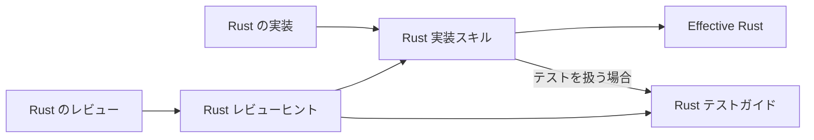

# [Design Doc] Codex の Rust 実装・レビュー方針

- Owner: Repository owner
- Drafted with: Codex
- Date: 2026-11-03
- Status: Approved by the repository owner on 2026-11-03

## Context and scope

Codex が書くコードは指示をしない場合、可動性の点で少し問題になることがある。これを修正し、 Effective Rust と Rust の慣習に沿ったコードを書かせたい
加えて、各モジュールの `pub` API を従来の `foo/mod.rs` に相当する `foo.rs` へ置くことや、単体テストと Cargo の `tests/` の使い分けについて、自身の方針を実装とレビューの両方へ反映したい。

現在は、Rust 実装スキル、TDD の Rust 参照、Rust レビューヒントに関連する指示が分かれている。
公開 API の配置とテスト配置は既に記述されている一方、Effective Rust は準拠先として明記されていない。
そのため、現在の指示だけでは、個別ルールの背景にある準拠先を読み取れない。

今回の設計では、Effective Rust を参照する方針と、ユーザーが明示した個人ルールを保存し、それらが実装側とレビュー側へ届く構成を整理する。
スキル内のコード例は少なくし、重要なルールのみを適用できるようにする。

### Goals

- Effective Rust と個人ルールを、実装・レビューで参照できる形にする。
- 公開 API とテストの配置について、両者が同じ基準を使えるようにする。
- 一般知識やコード例の重複を減らし、方針とその理由を保守しやすくする。

### Non-goals

- 他言語のヒント全体や、エージェント構成の再設計。
- 既存の Rust プロジェクトに対する一括移行。
- 今回の整理によるモデル性能やコスト改善を、未計測のまま保証すること。

## Overview

Rust の実装とレビューで、Effective Rust と個人ルールを共通の判断基準として使う。Effective Rust は、扱う設計・実装判断に関係する項目を参照する。スキル内のコード例は必要なものに絞り、書籍の指針を確認できる形を保つ。

実装方針と公開 API の配置は Rust 実装スキル、テスト配置は Rust テストガイドにまとめる。Rust レビューヒントは、この二つの資料へ案内する入口とする。実装側とレビュー側が同じ資料を読むことで、規則の重複と更新時の不整合を減らす。

モジュールの公開 API は親ファイル `foo.rs` に定義し、子ファイルへ内部実装を分けることを基本とする。責務をまとめやすくなる場合や、配置のためだけの重複を避けられる場合には、公開契約の適切さを確認したうえで、子の定義を親から再エクスポートしてよい。いずれの場合も公開窓口を親に保つ。

テストは、モジュールの公開契約を確認するもの、内部実装の単体テスト、統合された振る舞いを確認するものに応じて配置する。公開 API のテストは対応する `<module>_test.rs`、内部実装のテストは実装の近くに置き、Cargo の `tests/` は統合テストに使う。

## Detailed design

この章では、CodexがRustを実装する際に用いるスキルについて下記の観点で整理する

- スキルを構成する各ファイルの責務とその分類の定義
- それぞれのファイルが参照する資料とその役割
- 参照先と個人ルールの関係
- 実装とレビューへの参照経路

また、個人ルールとして、モジュール構造や公開APIの配置、テスト配置の方針を明示する。

### 方針を置く資料とその役割

個人ルールを持つファイルを実装側とレビュー側が共通で参照する。
実装方針は Rust 実装スキル、テスト配置は Rust テストガイドが担当し、Rust レビューヒントはそれらへ案内する入口とする。
規則の正本を分野ごとに一つにすることで、同じ方針を実装用とレビュー用に二重に書き、更新のたびに両者を合わせ直す負担を減らす。

| ファイル | 持たせる責任 | 利用する場面 |
| --- | --- | --- |
| `codex/skills/rust-implementation/SKILL.md` | Effective Rust の参照方針と、公開 API の配置などの個人ルール | Rust の実装と、その実装方針を確認するレビュー |
| `codex/skills/test-driven-development/references/rust.md` | 単体テスト・Cargo の `tests/` などの配置と使い分け | Rust テストの作成・変更と、そのレビュー |
| `codex/skills/review/hints/rust.md` | 上の二つの資料を必要な場面で読むための案内 | Rust レビューの開始時 |

### 準拠先と個人ルールの関係

Effective Rust は、Rust の慣習に沿った実装を判断するための準拠先とする。
Rust 実装スキルに同書への参照と適用方針を明記し、扱う設計・実装判断に関係する項目を利用する。
個々の推奨や例をスキルへ書き写して独立した規則集にせず、元の意図を参照できる形を保つ。
言語や標準ライブラリの具体的な仕様、バージョン依存の振る舞いは、プロジェクトのツールチェーンに合う公式資料で確認する。

公開 API の配置、テスト配置、エラー契約、空行、文書コメントの方針は、ユーザーが明示した個人ルールとして、それぞれの正本に残す。
リポジトリ固有の規約と承認済みの設計・契約を個人の既定方針より優先する関係は、現在のグローバル指示と Rust 実装スキルに既に規定されている。
今回もこの関係を引き継ぎ、対象外の既存コードを一括で揃える作業へ広げない。

### 実装とレビューへの参照経路

現在、実装側は[グローバル指示](../../codex/AGENTS.global.md)で Rust 実装スキルを読むよう求められている。
計画タスクと軽量タスクの双方から参照される[実装品質ガイド](../../codex/skills/execute-task/references/implementation-quality.md)にも、該当言語の実装スキルを読む指示がある。
レビュー側は[review スキル](../../codex/skills/review/SKILL.md)が対象言語のヒントを読み込み、レビュアーへ渡す。
さらに、実装品質のレビューでは review-depth から実装品質ガイドへ進む経路がある。

この既存の入口を使い、Rust レビューヒントから Rust 実装スキルと Rust テストガイドへ明示的に案内する。
Rust 実装スキルにも、テストの境界や配置を扱う場合に Rust テストガイドを読むための参照を置く。
以下の矢印は資料を参照する関係を示すもので、コマンドの実行順を表さない。

代表的な流れとして、Rust の変更に着手する側は Rust 実装スキルを読み、扱う判断に関係する Effective Rust の指針と個人ルールを適用する。
テストの境界や配置を決める場合は Rust テストガイドも参照する。
レビュー側は短い Rust レビューヒントを入口として同じ資料へ進み、実際の公開 API、内部実装、テスト配置をその方針に照らして確認する。

Rust のテスト配置は、現在のヒントにも詳しく書かれているが、[Rust テストガイド](../../codex/skills/test-driven-development/references/rust.md)へのリンクはない。
ヒントを短くする際は、複製していた配置規則をこのリンクに置き換える。
[TDD スキル](../../codex/skills/test-driven-development/SKILL.md)から Rust テストガイドへ進む既存の経路も同じ正本を参照するため、テスト配置の基準を揃えられる。

ヒントが持つのは資料を選ぶ役割であり、個人ルールの本文は参照先が持つ。
レビュアーは、その作業に適用される規約と承認済みの範囲に照らして実装を評価する。
これにより、ヒント自体を必須の実装規約にすることなく、参照先の個人方針まで確認できる構成にする。

### モジュールの公開 API の配置

各モジュールの公開 API は、ディレクトリ名と同じ親ファイル `foo.rs` に定義することを基本とし、子ファイルには内部実装を分ける。
親を読むことで API の形を確認しやすくし、内部実装の分割を利用側へ持ち出さないためである。
この方針は、クレート内のモジュール間 API にも適用する。

ただし、後述の「再エクスポートを許容する基準」に従い、必要であれば子に定義した項目を親から再エクスポートしてよい。
その場合も、公開窓口は親に保つ。

親から子の処理を呼ぶ場合は、`pub(super)` など、内部で必要な最小限の可視性を与える。
小さなモジュールは一つのファイルに留めてよく、配置規則のためだけに子ファイルを作る必要はない。

#### 再エクスポートを許容する基準

親の公開窓口を維持しながら、次のいずれかの利点がある場合に再エクスポートを許容する。

- 型・その実装・内部ヘルパーを一つの責務として子にまとめることで、変更箇所や守る条件を追いやすくなる。
- 公開する定義を親へ置くためだけの転送関数、同じ意味・形の型、値の詰め替えを避けられる。

再エクスポートする型・操作・エラーは、そのモジュールの公開契約として適切なものに限定する。
親から意図した項目を再公開し、利用側が内部の子モジュールを直接たどる構成へ変えない。

内部型を再利用して詰め替えを減らせる場合も、その型を公開することの適切さを確認する。
検証や意味の変換、内部表現の隠蔽を担う型や変換処理は、その役割に基づいて維持する。

これは、必要以上に公開すると将来変更できる範囲が狭くなるという、[Effective Rust の可視性の指針](https://effective-rust.com/visibility.html)にも沿う。
行数やファイル数だけで判断せず、責務のまとまりや重複が具体的に改善するかを確認する。

再エクスポートは、定められた公開契約の範囲内で選択する。
公開 API の追加・変更が必要になる場合は、配置の都合とは別の設計判断として扱う。

### テストの境界と配置

モジュールの公開契約を検証するテストと、内部実装の単体テストを分けて配置する。

| テスト対象 | 配置 |
| --- | --- |
| モジュールの公開 API を通した振る舞い | 対応する `<module>_test.rs` |
| 内部実装の責務・細かな条件 | 実装ファイル内、または対応する `<file_name>_test.rs` |
| 複数コンポーネントの連携、実プロセスなどの統合された振る舞い | Cargo の `tests/` |

公開 API のテストは、そのモジュールの公開契約を確認し、内部の補助関数や表現へ依存させない。
内部実装の単体テストは、その責務を持つ実装の近くに置く。
公開 API を使うという理由だけでは `tests/` に配置しない。
テストのためだけに本番コードの可視性を広げない。

配置の正本は [Rust テストガイド](../../codex/skills/test-driven-development/references/rust.md)とし、実装・レビューから同じ資料へ進む。
AAA や一つの振る舞いに焦点を合わせることなど、言語共通のテスト方針は [TDD スキルの Test contract](../../codex/skills/test-driven-development/SKILL.md#test-contract)を参照する。
Rust 固有の配置と接続方法だけを Rust テストガイドで具体化し、レビューヒントへ規則の全文を複製しない。

## Alternatives considered

### 公開する定義をすべて親ファイルに固定する

公開 API の形を一か所で確認でき、配置の判断も単純になる。
ただし、この規則に合わせるためだけの転送関数、型の重複、値の詰め替えが増えたり、型と関連する実装を一つの責務としてまとめにくくなったりする場合がある。
公開窓口を親に保つ目的は条件付きの再エクスポートでも満たせるため、親への定義を基本としながら、具体的な利点がある場合は再エクスポートを許容する。

### 内部の子モジュールをそのまま公開する

子を `pub mod bar` として公開し、利用側が `foo::bar::fuga()` のように使う構成では、分野ごとの名前空間を利用側にも見せられる。
一方、今回内部実装として分割する子をこの方法で公開すると、その分割が利用側のパスと契約に入り、内部構成を変更する負担が増える。
今回の配置方針では公開窓口を親に保ち、子は内部の責務を担当させる。
独立した意味を持つ公開サブモジュールの是非は、そのモジュールの設計として判断する。

### Effective Rust を参照できない場合は判断を保留する

Rustのベストプラクティスなどは公式のDocやモデル自体の知識でもある程度は担保でき、Effective Rustが参照できないことをタスクを止める根拠にするのは思考停止のようなものに近い。
そのため、この案は採用しなかった。

## 参照

- [Effective Rust](https://effective-rust.com/) — Rust 実装・レビューの準拠先。
- [The Rust Reference: Re-exporting and visibility](https://doc.rust-lang.org/reference/visibility-and-privacy.html#re-exporting-and-visibility) — 再エクスポートの言語仕様。配置方針の採用を意味するものではない。
